# Multimodal RAG architecture posters

> Rendered visual companions to the canonical [architecture handbook](ARCHITECTURE.md).
> The handbook and current editable SVG/Mermaid diagrams are authoritative.
> Older PNG posters below are historical or target illustrations, not current permissions.

## Current retained demo architecture — October 18

Phase 11's qualified two-person learning acceptance is merged in PR #31 (`768a67f`).
The existing deployment remains available for inspection of READY documents and
saved answers/citations. Worker stopped/restart-no; existing maintenance unchanged;
no new paid calls or resources. A stopped worker does not disable API chat: the
inspection restriction is operator-controlled, not a new runtime/UI interlock.

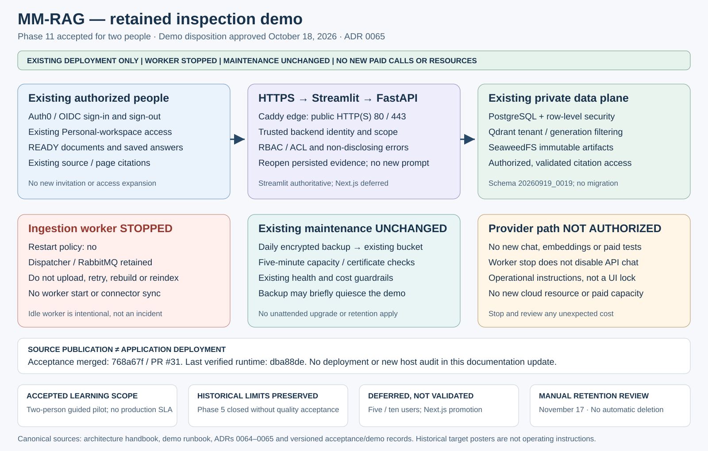

## Phase 11 closure and demo lifecycle

Five-/ten-user validation and Next.js promotion remain deferred. Phase 5 closed
without quality acceptance. This is learning-project closure, not production certification.

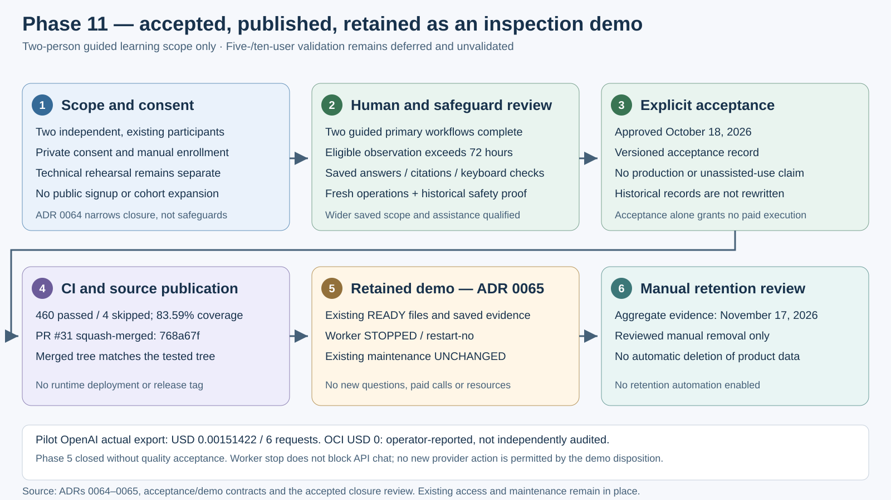

## Historical Phase 10 operational illustration

This view shows the implemented plan/authorize/evidence loops around the accepted
free-first learning deployment at its original illustration checkpoint. Its pending
labels predate accepted Phase 10 evidence; the handbook and current demo SVG above
supersede those status labels. Existing maintenance remains unchanged.

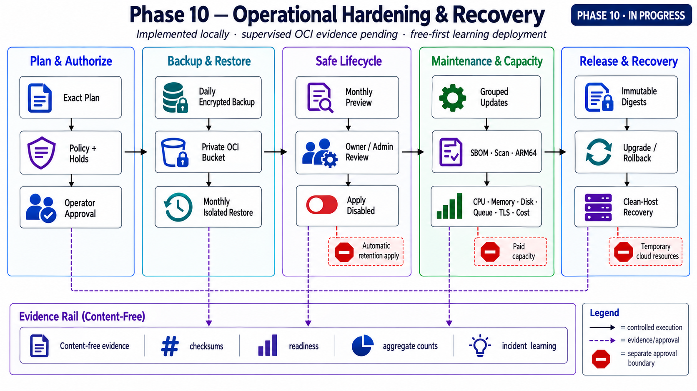

## Phase 7 workflow and DEV architecture reference

This historical developer-capability view shows the Phase 3/4 runtime and governance
boundaries, Phase 5 hybrid retrieval foundation, Phase 6 visual/table extraction,
and the Phase 7 evaluation and observability layer. Phase 6 remains released at
`mm-rag-v6.0.0`; Phase 7 is accepted with its seven-day baseline and pilot SLOs.
Its development ports, schema and retry labels are historical, not the current demo
runtime or permission to execute paid workflows. Its stable filename is preserved.

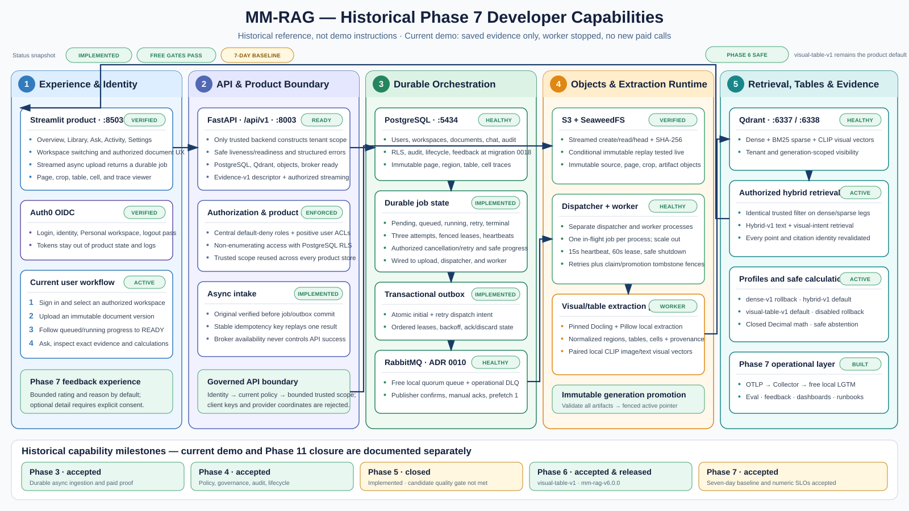

## Target production architecture — not a completion claim

This is an aspirational target system without phase or roadmap labels. It does not
claim the learning deployment implements every component or provides a production SLA.

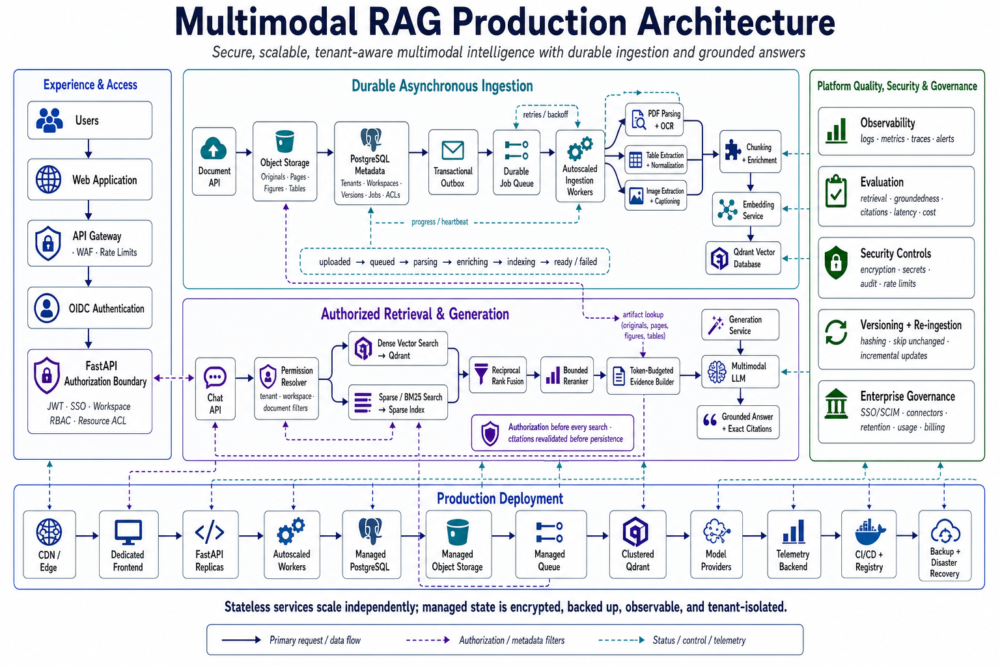

## Historical system and evolution roadmap

This original roadmap is retained for design history. Use the current lifecycle
SVG and handbook for accepted, closed-without-acceptance and deferred phase status.

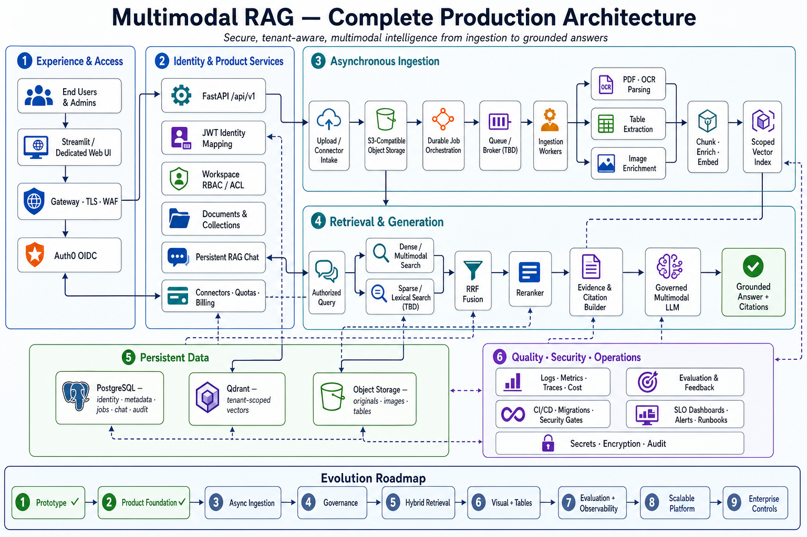

## Phase 1 — Working prototype

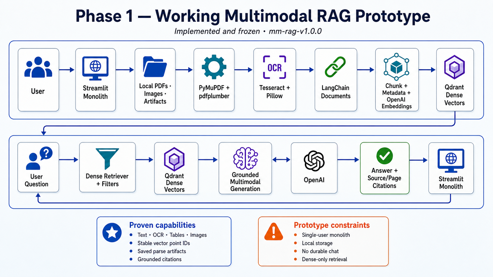

## Phase 2 — Secure product foundation

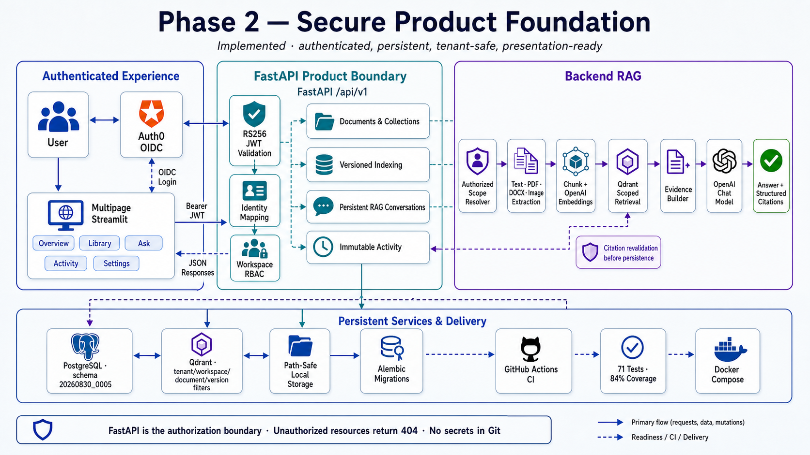

## Phase 3 — Durable asynchronous ingestion

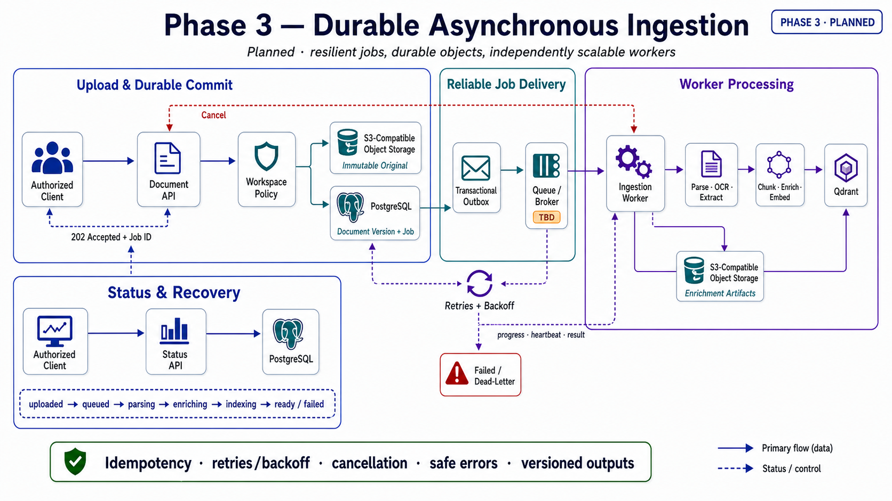

## Phase 4 — Fine-grained authorization and governance

The poster is the Phase 4 target-state companion. The editable
[Phase 4 policy matrix and threat model](PHASE4_POLICY_THREAT_MODEL.md) is implemented
through migration `20260831_0013`; Milestones 4.0–4.5 pass deterministic and free
live-service evidence and are accepted in PR #3's squash commit `57ee453`.

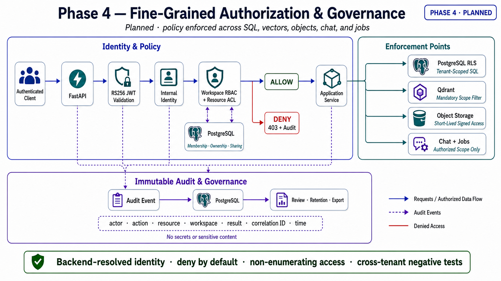

## Phase 5 — Hybrid retrieval, fusion, and reranking

Historical target: Phase 5 closed without quality acceptance. `hybrid-v1` remains
the default, `dense-v1` the rollback and `hybrid-v3` evaluation-only/unpromoted.

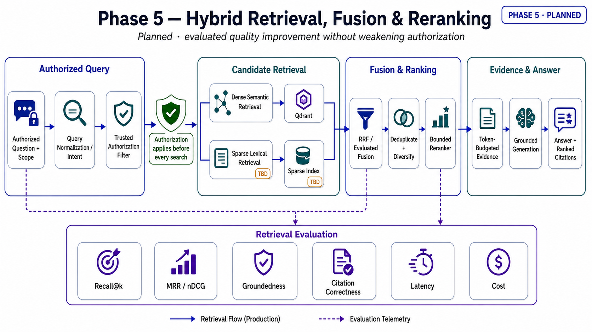

## Phase 6 — Visual and table intelligence

This poster records the accepted and released Phase 6 visual/table architecture.

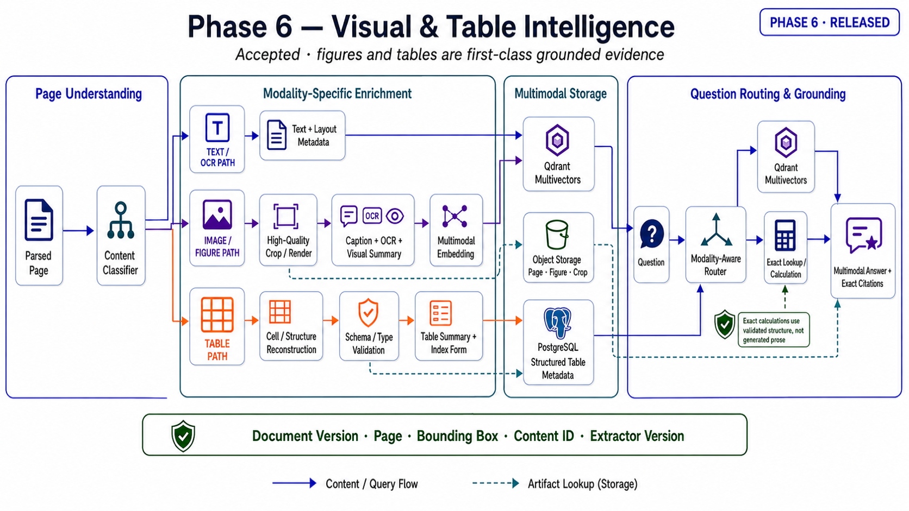

## Phase 7 — Evaluation and observability

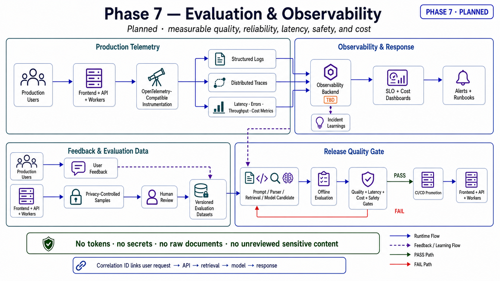

## Phase 8 — Scalable production platform

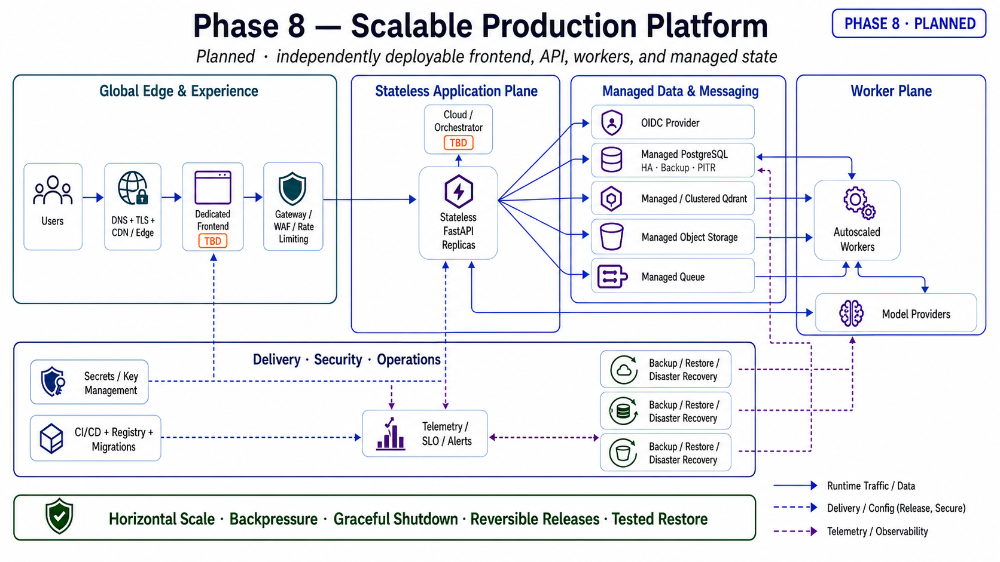

## Phase 9 — Enterprise integrations and commercial controls

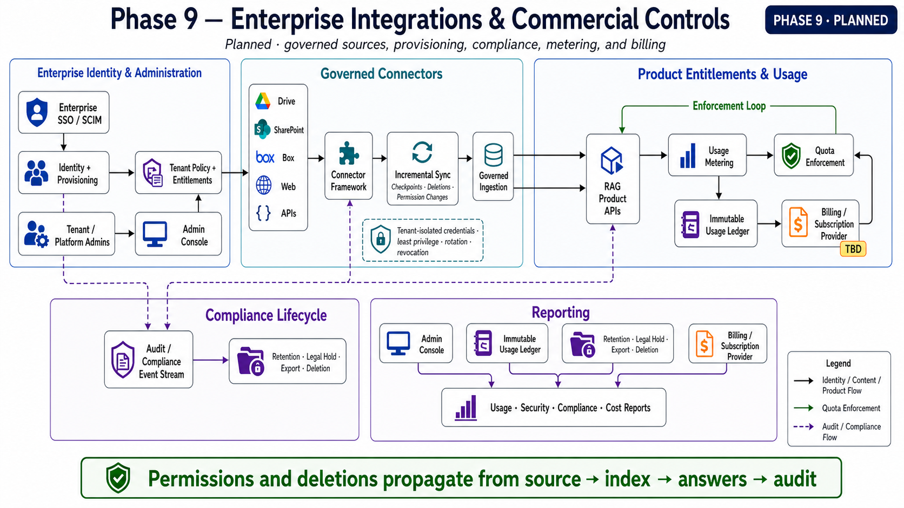

## Phase 10 — Operational hardening and recovery

## Maintenance rule

1. Update `ARCHITECTURE.md` first.
2. Update the current editable Mermaid/SVG view and render it locally for review.
3. Verify technical labels, scope limits and flows against the handbook and ADRs.
4. Preserve clearly labeled historical/target PNGs and immutable release evidence.
   Paid image generation is not authorized for this update; the legacy visual
   specification remains in [`images/README.md`](images/README.md).
